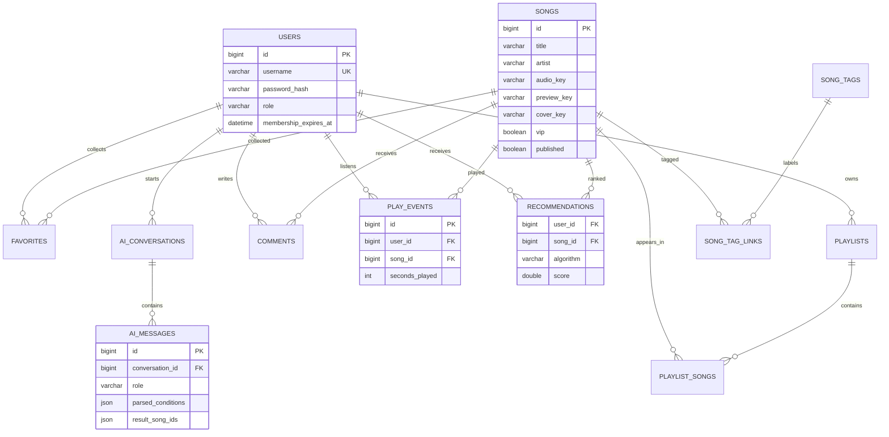

# 系统设计与 E-R 图

## 运行结构

Vue 3 前端通过 REST API 调用 Spring Boot 服务。Spring Security 负责令牌和角色拦截；MySQL 保存业务记录；Redis 保存登录令牌、热门曲库缓存、推荐缓存与 AI 限额；MinIO 保存私有音频、独立试听文件及封面。Spring Task 每天 06:00 重算推荐。DeepSeek 仅提取自然语言检索条件，最终结果由本地已上架曲库查询产生。

## 核心数据关系

完整字段、约束与索引见 `code/src/main/resources/db/migration/V1__schema.sql`。`membership_expires_at` 为会员资格的唯一来源，过期时间由管理员设置；`vip` 表示歌曲需要会员才能完整播放。

## 文件与权限边界

- 上传与本地导入写入 MinIO 私有桶；数据库只存对象键。已上架封面通过公开接口转发。
- 音频接口每次读取当前账号会员状态。VIP 非会员只能请求独立 30 秒试听对象，不能通过 Range 取得完整音频对象。
- 用户无法访问其他用户的歌单或 AI 会话；管理员接口必须为 `ADMIN`。评论经审核后才公开展示。

## 导入数据

读取 `img/_cover-manifest.json`，以 `category/file` 与 `music` 目录配对、以 `image` 字段与 `img` 目录配对。`source_path` 唯一键使重跑可跳过已导入记录。当前清单包含 461 条 `matched` 记录及两条因标题为 `null` 而跳过的 `review` 记录；历史上的 43 条 HTML 伪音频及其封面已删除。导入后可由管理员完善流派、情绪等标签。初始歌曲均为免费，避免在没有 FFmpeg 的机器上出现无法安全试听的 VIP 歌曲。
